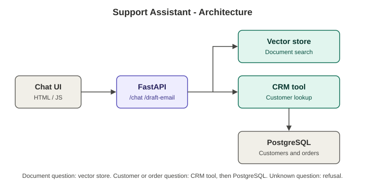

# Support Assistant with End-to-End Tests

## 1. Purpose
A small customer-support assistant built with FastAPI.

- Answers questions from company documents (document Q&A)
- Looks up customers and orders with tools (CRM tool, order tool)
- Refuses to answer when it does not know ("I don't know based on the available information.")
- Drafts a summary email from the conversation (it never sends the email)

The project also has end-to-end tests, mocked unit tests for the tools, and a secrets check.

## 2. Architecture sketch



```
Chat UI  -->  FastAPI  -->  Vector store          (document questions)
                       -->  CRM tool  -->  PostgreSQL   (customer and order questions)
```

| Part | What it does |
|------|--------------|
| Chat UI | The page where the user types a question |
| FastAPI | Receives the question, chooses document search or a tool, returns the answer |
| Vector store | Finds the right document text for a question |
| CRM tool | Looks up a customer record |
| PostgreSQL | Stores customers and orders |

Note: in this test project the vector store and PostgreSQL are replaced by
built-in data inside `main.py`, so everything runs without extra services.
The tool functions stay the same, so a real database can be connected later.

## 3. Setup steps
```powershell
git clone https://github.com/<your-username>/<your-repo>.git
cd <your-repo>
python -m venv venv
.\venv\Scripts\activate
pip install -r requirements.txt
copy .env.example .env
```

## 4. Environment variables
Set these in the `.env` file. Never commit `.env` (it is listed in `.gitignore`).

| Variable | Meaning | Example |
|----------|---------|---------|
| `BASE_URL` | Address of the API used by the test script | `http://127.0.0.1:8000` |
| `CRM_URL` | Address used by the CRM tool | `http://127.0.0.1:8000/crm` |
| `ORDER_URL` | Address used by the order tool | `http://127.0.0.1:8000` |
| `API_KEY` | Key sent in the `X-API-Key` header | `your-key-here` |

## 5. How to run

Terminal 1 - start the server and leave it running:
```powershell
uvicorn main:app --reload
```
Open http://127.0.0.1:8000/docs to try the API in the browser.

Terminal 2 - run the tests:
```powershell
python e2e_test.py before    # known bugs switched on: 7 of 10 pass
python e2e_test.py after     # bugs fixed: 10 of 10 pass
pytest test_tools.py -v      # 6 unit tests with mocked responses
python check_secrets.py      # checks for hardcoded secrets
```

## 6. Example questions
Send these to `POST /chat` with a body like `{"session_id": "demo1", "message": "..."}`.

| Type | Question | Expected result |
|------|----------|-----------------|
| Document | What is the refund policy? | 30-day refund policy |
| Document | What are the support working hours? | 9 am to 6 pm, Monday to Friday |
| CRM | Show details for customer Rahul | Customer record |
| Order | What is the status of order 1001? | Shipped |
| Unanswerable | What is the CEO's home address? | "I don't know based on the available information." |
| Email draft | `POST /draft-email` with `{"session_id": "demo1", "tone": "formal"}` | Subject and body |

## 7. Project files
| File | Purpose |
|------|---------|
| `main.py` | FastAPI app |
| `crm_tool.py` | CRM tool |
| `order_tool.py` | Order tool |
| `e2e_test.py` | 10 end-to-end scenarios and results table |
| `test_tools.py` | Unit tests for both tools |
| `check_secrets.py` | Secrets check |
| `TEST_REPORT.md` | Test report |
| `docs/architecture.svg` | Architecture diagram |